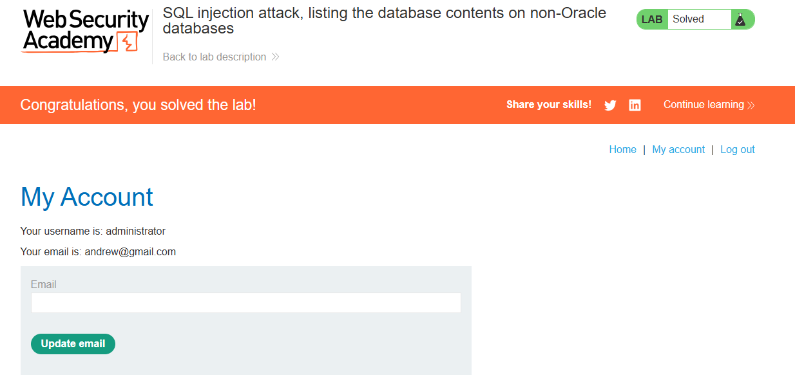

# PortSwigger Web Security Academy: SQL Injection (SQLi) – Listing Database Contents on Non-Oracle Databases

## Executive Summary
This repository documents completion of PortSwigger Web Security Academy's intentionally vulnerable SQL injection lab, which uses a product category filter and a PostgreSQL database. The exercise demonstrates how a UNION-based SQL injection can expose database metadata and account data in a controlled environment.

---

## Technical Objectives
* **Vulnerability Identification:** Confirm SQL injection vulnerability within the `category` filter parameter.
* **Database Fingerprinting:** Determine the exact number and data types of columns returned by the original query, and identify the database type.
* **Schema Mapping:** Query the database's information schema to locate custom user data tables.
* **Data Exposure:** Observe how the vulnerable query can expose account attributes, demonstrating the potential impact in this authorized lab.

---

## Penetration Testing Methodology & Execution

### Phase 1: Reconnaissance & Column Determination
Initial testing confirmed that the `/filter?category=` endpoint was vulnerable to SQL injection. By injecting standard `UNION SELECT` payloads, I determined that the query returns **two columns** and that both columns accept **string/text data**. 

*Payload Used:*
```sql
' UNION SELECT 'column1', 'column2'--
```

### Phase 2: Database Schema Enumeration (Table Discovery)
The lab uses PostgreSQL, so I queried the standard `information_schema.tables` view to identify table names visible to the database account. This view describes relations in the current database; it does not necessarily list every table or PostgreSQL system catalog.

*Injected Payload:*
```http
/filter?category=Lifestyle' union select table_name, null from information_schema.tables--
```

*Analysis of Output:*
The response included table names exposed by the query. Among them, I identified the lab's randomly named users table:
* Target Table Identified: **`users_ccdipi`**

### Phase 3: Column Enumeration
With the targeted table name isolated, the next step was to map out its internal structure to identify where credentials were explicitly stored. I queried `information_schema.columns` filtering strictly for the newly discovered table.

*Injected Payload:*
```http
/filter?category=Lifestyle' union select column_name, null from information_schema.columns where table_name = 'users_ccdipi'--
```

*Analysis of Output:*
The resulting application view exposed two specific randomized column headers designated for sensitive data storage:
1. **`username_ryprbe`** (Stores the account usernames)
2. **`password_pwdizq`** (Stores the account passwords)

### Phase 4: Data Exfiltration (Exploit Execution)
Armed with the exact table and column identifiers, I crafted the final `UNION SELECT` statement to pull the raw credentials directly out of the application database into the public-facing webpage.

*Final Exploit Payload:*
```sql
Lifestyle' union select username_ryprbe, password_pwdizq from users_ccdipi--
```

*Results:*
The lab returned the account data, allowing me to identify the administrator credentials and complete the exercise.



---

## Remediation & Mitigation Strategies
To secure this application against UNION-based SQL injection attacks, developers should implement the following defenses:

1. **Use Parameterized Queries (Prepared Statements):** Ensure all user-supplied input is treated strictly as data, never executable code. This is the single most effective defense against SQLi.
   ```java
   // Example Secure Java Implementation
   String query = "SELECT * FROM products WHERE category = ?";
   PreparedStatement pstmt = connection.prepareStatement(query);
   pstmt.setString(1, userCategory);
   ResultSet results = pstmt.executeQuery();
   ```
2. **Input Validation & Whitelisting:** Implement strict input validation on the backend. If categories are static (e.g., 'Gifts', 'Lifestyle'), accept only known valid strings and reject any inputs containing special characters like `'`, `-`, or `UNION`.
3. **Principle of Least Privilege:** Ensure the database account used by the application has only the permissions it needs. Avoid granting unnecessary access to application data or database metadata.

---
*Disclaimer: This write-up is created strictly for educational purposes and professional portfolio building as part of my journey through the PortSwigger Web Security Academy.*
